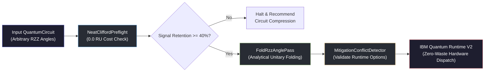

# qiskit-neat-fold ⚡

[](https://opensource.org/licenses/MIT)
[](https://www.python.org/downloads/)
[](https://qiskit.org/)
[](https://qiskit-neat-fold.vercel.app)

**Topological angle folding, zero-RU pre-flight Clifford verification, and error mitigation conflict detection for IBM Quantum Runtime V2.**

> 🌐 **Interactive Live Web Demo:** Deployable with 1-click on Vercel Serverless (`api/index.py`) providing instantaneous browser-based angle folding, Clifford pre-flight estimation, and Mode A vs Mode B conflict inspection.

---

## Overview

In contemporary superconducting architectures with fixed-frequency transmons (e.g., **IBM Quantum Heron r2** processors like `ibm_kingston`, `ibm_marrakesh`, and `ibm_fez`), native cross-resonance and $R_{ZZ}(\theta)$ interactions are physically calibrated over the fundamental parameter domain:

$$\theta \in \left(0, \frac{\pi}{2}\right]$$

Submitting quantum circuits with arbitrary angles outside this calibrated window frequently causes:
1. **Transpiler de-optimizations:** Unnecessary decompositions into multi-CX synthesis cascades, inflating gate counts and increasing dephasing.
2. **Runtime dispatch warnings or failures:** Hardware errors or uncalibrated microwave pulse synthesis.
3. **Wasted Quantum Seconds (RUs):** Jobs executed on noisy physical QPUs with excessive depth or incompatible mitigation options (e.g., mixing fractional gates with Pauli twirling, or stacking TREX with M3).

`qiskit-neat-fold` solves these challenges via an autonomous 3-pillar pipeline:
- **`FoldRzzAnglePass`**: An analytical Qiskit `TransformationPass` that maps any $R_{ZZ}(\theta)$ angle into $(0, \pi/2]$ with exact unitary equivalence up to a global phase, without inserting spurious `GlobalPhaseGate` nodes.
- **`NeatCliffordPreflight`**: A 0.0-RU pre-flight verification tool estimating Clifford signal retention under calibrated hardware noise prior to dispatch.
- **`MitigationConflictDetector`**: A static validator preventing illegal mitigation combinations (Mode A vs Mode B clashes).

---

## Architecture and Pipeline



---

## Mathematical Formulation

The two-qubit rotation operator is defined as:
$$R_{ZZ}(\theta) = \exp\left(-i \frac{\theta}{2} Z \otimes Z\right)$$

Using the algebraic properties of Pauli operators:
1. **Periodicity:** $R_{ZZ}(\theta + 2\pi) = -R_{ZZ}(\theta) \equiv R_{ZZ}(\theta)$ (up to a global phase).
2. **Sign Inversion:** $R_{ZZ}(-\theta) = (X \otimes I) R_{ZZ}(\theta) (X \otimes I)$.
3. **Reflection:** $R_{ZZ}(\pi - \theta) = -i (Z \otimes Z) R_{ZZ}(-\theta) = -i (Z \otimes Z) (X \otimes I) R_{ZZ}(\theta) (X \otimes I)$.

By applying single-qubit Clifford corrections ($X$, $Z$), any continuous rotation $\theta \in \mathbb{R}$ is folded strictly into $\theta' \in (0, \pi/2]$ while preserving the exact two-qubit unitary.

---

## Installation

```bash
git clone https://github.com/kleitonbernardino-lab/qiskit-neat-fold.git
cd qiskit-neat-fold
pip install -e .
```

---

## Quickstart

```python
from qiskit import QuantumCircuit
from qiskit.transpiler import PassManager
from qiskit_neat_fold import FoldRzzAnglePass, NeatCliffordPreflight, MitigationConflictDetector

# 1. Define circuit with out-of-bounds angles
qc = QuantumCircuit(2)
qc.h(0)
qc.rzz(2.67035, 0, 1)  # Exceeds pi/2

# 2. Run Pre-flight Check (0.0 RU cost)
preflight = NeatCliffordPreflight()
result = preflight.evaluate(qc, shots=4096)
print(f"Viable: {result.is_viable}, Clifford Retention: {result.clifford_retention:.2%}")

# 3. Transpile with FoldRzzAnglePass
pm = PassManager([FoldRzzAnglePass()])
folded_qc = pm.run(qc)
print(folded_qc.draw())

# 4. Validate Runtime Mitigation Options
detector = MitigationConflictDetector(strict=True)
options = {
    "use_fractional_gates": True,
    "twirling": {"enable_gates": False, "enable_measure": True},  # Mode A compliant
    "use_m3": False,
}
detector.inspect_options(options)
```

---

## License

MIT License. See [LICENSE](LICENSE) for details.
